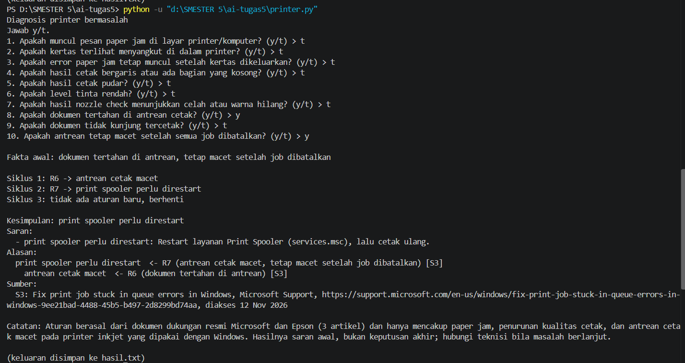
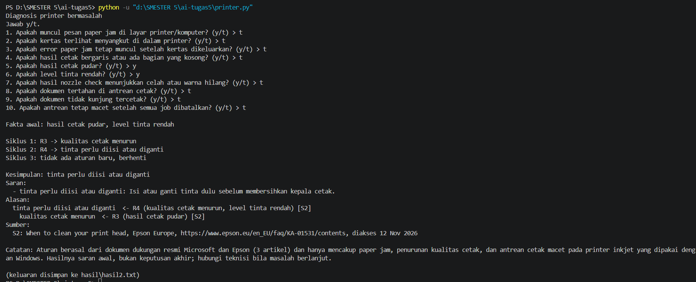
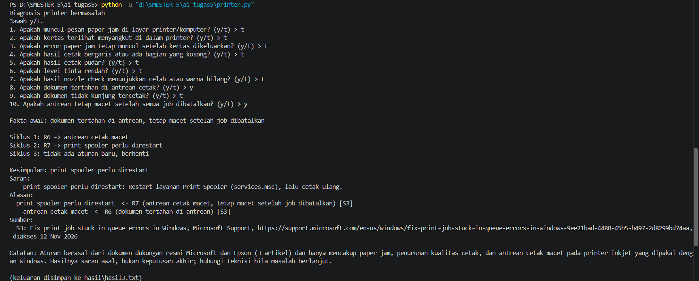
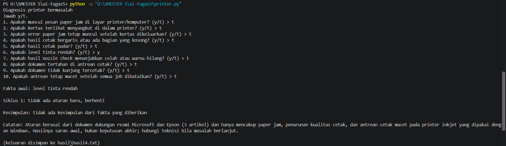

# Tugas 5 — Sistem Pakar Diagnosis Printer Bermasalah

**Nama:** [BAIQ SABRINA RAMADHANI]  
**NIM:** [F1D02410040]

## Topik dan cara menjalankan
Sistem pakar sederhana untuk mendiagnosis masalah printer inkjet: paper jam, penurunan kualitas cetak, dan antrean cetak macet. User menjawab pertanyaan ya/tidak tentang gejala, lalu program menyimpulkan penyebab, saran, dan alasannya.

- **Bahasa:** Python 3.14, tanpa library tambahan (hanya modul bawaan `json` untuk membaca file aturan)
- **Menjalankan program:** buka terminal di dalam folder proyek, lalu ketik
  ```
  python printer.py
  ```
  (di Windows bisa juga `py printer.py`)
- **Menjalankan uji otomatis:** `python test_printer.py`, hasil yang benar adalah semua `LULUS` lalu `Semua lulus`

**Cara mengisi jawaban:** program menampilkan pertanyaan bernomor, misalnya `1. Apakah muncul pesan paper jam di layar printer/komputer? (y/t) >`. Ketik `y` untuk ya atau `t` untuk tidak, lalu Enter. Setelah semua dijawab, program menampilkan siklus, kesimpulan, saran, alasan, sumber, dan catatan batas keberlakuan.

**Penyimpanan hasil:** setiap kali dijalankan, seluruh keluaran otomatis disimpan berurutan ke `hasil/hasil1.txt`, `hasil/hasil2.txt`, dan seterusnya. Folder `hasil` harus sudah ada (sudah disertakan di repo).

### Struktur file
| File / folder | Isi |
|---|---|
| `kb_printer.json` | Basis pengetahuan: judul, catatan batas, sumber, pertanyaan, saran, dan 7 aturan IF-THEN |
| `printer.py` | Program: pembaca file aturan, mesin forward chaining, tampilan, dan penyimpan hasil |
| `test_printer.py` | Uji otomatis (opsional) |
| `hasil/` | Keluaran teks tiap kali program dijalankan |
| `screenshot/` | Tangkapan layar kasus uji |

Satu aturan di `kb_printer.json` ditulis seperti ini:

```json
{"id": "R2", "jika": ["kertas macet", "error tetap setelah kertas dikeluarkan"],
 "mode": "dan", "maka": "sisa kertas atau sensor jam masih aktif", "sumber": "S1"}
```

`mode` bernilai `dan` (semua syarat harus ada) atau `atau` (salah satu cukup). Mesin forward chaining tidak berisi pengetahuan tentang printer; seluruh pengetahuan ada di file JSON.

## Sumber
| Kode | Judul | Penerbit | URL | Tanggal akses |
|---|---|---|---|---|
| S1 | Fix printer stopped due to paper jam errors in Windows | Microsoft Support | https://support.microsoft.com/en-us/windows/hardware/printer/fix-printer-stopped-due-to-paper-jam-errors-in-windows | 12 Nov 2026 |
| S2 | When to clean your print head | Epson Europe | https://www.epson.eu/en_EU/faq/KA-01531/contents | 12 Nov 2026 |
| S3 | Fix print job stuck in queue errors in Windows | Microsoft Support | https://support.microsoft.com/en-us/windows/fix-print-job-stuck-in-queue-errors-in-windows-9ee21bad-4488-45b5-b497-2d8299bd74aa | 12 Nov 2026 |

Aturan adalah parafrasa, bukan kutipan. Isi yang diambil dari sumber:

- **S1:** matikan printer dan cabut kabel; keluarkan kertas dari nampan masukan, pintu belakang, dan area kartrid; sobekan kecil yang tertinggal bisa membuat sensor jam tetap aktif; periksa roller; nyalakan ulang printer.
- **S2:** pembersihan kepala cetak mengatasi garis, warna hilang, dan cetakan pudar; pastikan tinta cukup sebelum membersihkan; bila nozzle check menunjukkan celah atau warna hilang, jalankan head cleaning; jangan membersihkan saat tinta rendah.
- **S3:** batalkan semua job di antrean cetak; bila belum beres, restart layanan Print Spooler; bila masih macet, kosongkan folder spool, lalu restart printer dan PC.

Rumusan saya sendiri (gabungan dari sumber, bukan kalimat sumber): menganggap "error tetap muncul setelah kertas dikeluarkan" sebagai tanda sisa kertas atau sensor jam masih aktif (R2), mendahulukan pengisian tinta sebelum pembersihan kepala cetak (R4), dan menjadikan gejala "dokumen tidak kunjung tercetak" sebagai tanda antrean macet (R6).

## Tabel aturan
| Aturan | IF | THEN | Sumber |
|---|---|---|---|
| R1 | pesan paper jam muncul **OR** kertas terlihat menyangkut | kertas macet | S1 |
| R2 | kertas macet **AND** error tetap setelah kertas dikeluarkan | sisa kertas atau sensor jam masih aktif | S1 |
| R3 | hasil cetak bergaris atau ada celah **OR** hasil cetak pudar | kualitas cetak menurun | S2 |
| R4 | kualitas cetak menurun **AND** level tinta rendah | tinta perlu diisi atau diganti | S2 |
| R5 | kualitas cetak menurun **AND** hasil nozzle check ada celah | kepala cetak tersumbat | S2 |
| R6 | dokumen tertahan di antrean **OR** dokumen tidak kunjung tercetak | antrean cetak macet | S3 |
| R7 | antrean cetak macet **AND** tetap macet setelah job dibatalkan | print spooler perlu direstart | S3 |

Rantai aturan (hasil satu aturan dipakai aturan lain): R1 → R2, R3 → R4, R3 → R5, R6 → R7.  
Kesimpulan akhir yang mungkin: sisa kertas atau sensor jam masih aktif, tinta perlu diisi atau diganti, kepala cetak tersumbat, print spooler perlu direstart, serta kertas macet dan antrean cetak macet bila rantainya berhenti di situ.

## Metode: Forward Chaining
Dipilih karena user umumnya tahu gejala (fakta) tetapi belum tahu penyebabnya, sehingga alurnya dari fakta menuju kesimpulan. Mesinnya ditulis sendiri di `printer.py` (`forward_chaining`) dengan langkah:

1. Memori diisi fakta yang dijawab "ya" oleh user.
2. Cari aturan yang syaratnya terpenuhi dan hasilnya belum ada di memori.
3. Jalankan aturan pertama yang cocok: tambahkan hasilnya ke memori dan catat aturan yang menghasilkannya.
4. Ulangi dari langkah 2; berhenti bila tidak ada aturan baru.

Kesimpulan akhir adalah hasil yang tidak dipakai sebagai syarat aturan lain yang berjalan. Alasannya dicetak dengan menelusuri catatan asal secara mundur (`cetak_alasan`), misalnya kesimpulan dari R2 ditelusuri sampai R1.

## Kasus uji
| # | Jawaban "ya" | Ketik `y` untuk nomor | Kesimpulan | Keluaran |
|---|---|---|---|---|
| 1 | pesan paper jam muncul, error tetap setelah kertas dikeluarkan | 1 dan 3 | sisa kertas atau sensor jam masih aktif | `hasil/hasil1.txt` |
| 2 | hasil cetak pudar, level tinta rendah | 5 dan 6 | tinta perlu diisi atau diganti | `hasil/hasil2.txt` |
| 3 | dokumen tertahan di antrean, tetap macet setelah job dibatalkan | 8 dan 10 | print spooler perlu direstart | `hasil/hasil3.txt` |
| 4 (negatif) | level tinta rendah saja | 6 | **tidak ada kesimpulan** | `hasil/hasil4.txt` |

Pertanyaan lainnya dijawab `t`. Kasus 4 tidak menghasilkan kesimpulan karena "level tinta rendah" baru dipakai bila kualitas cetak menurun (R4 butuh hasil R3). `test_printer.py` juga menguji kasus dengan dua kesimpulan sekaligus.

Kasus 1 (menghasilkan kesimpulan):  


Kasus 2 (menghasilkan kesimpulan):  


Kasus 3 (menghasilkan kesimpulan):  


Kasus 4 (tidak menghasilkan kesimpulan):  


## Batas keberlakuan
Pengetahuan dalam sistem ini berasal dari dokumen dukungan resmi Microsoft dan Epson (tiga artikel di atas), sehingga hanya berlaku untuk printer inkjet yang dipakai dengan Windows dan hanya mencakup paper jam, penurunan kualitas cetak, serta antrean cetak macet. Kasus di luar itu, misalnya kerusakan perangkat keras atau printer laser, tidak tercakup. Hasilnya adalah saran awal, bukan keputusan akhir; bila masalah berlanjut, hubungi teknisi atau dukungan resmi produsen. Catatan ini juga ditampilkan oleh program.

## Penggunaan alat bantu AI
Saya menggunakan Claude (AI) sebagai alat bantu untuk menyusun draf aturan dari sumber dan menulis kode awal program. Aturan dan kode tersebut saya periksa sendiri, dan saya memahami cara kerjanya